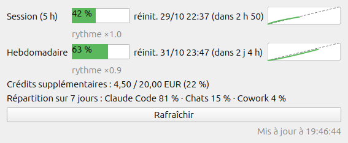

# ClaudeUsage

Affiche l'utilisation des limites d'un abonnement Claude (Pro / Max), en ligne de commande ou dans une petite interface Qt :

- **Session** : fenêtre glissante de 5 heures
- **Hebdomadaire** : limite sur 7 jours, plus les limites par modèle quand elles s'appliquent
- pour chaque limite : pourcentage utilisé, date de réinitialisation, temps restant, **rythme de consommation** et heure estimée à laquelle la limite sera atteinte
- **crédits d'usage supplémentaire** et **répartition** de la consommation hebdomadaire par produit

Les valeurs sont des **pourcentages** de la limite. Anthropic ne publie pas de plafond en nombre de tokens pour les abonnements.



*Capture réalisée avec des données fictives.*

## Prérequis

- Python 3.11 ou plus récent
- Claude Code installé et connecté avec un compte claude.ai. Les identifiants sont lus dans `~/.claude/.credentials.json`, ou dans le Trousseau sous macOS.
- Pour l'interface graphique : PyQt6 (`sudo apt install python3-pyqt6` ou `pip install PyQt6`)

## Installation

Les scripts fonctionnent directement depuis le dépôt (`./claude_usage.py`, `./claude_usage_qt.py`). On peut aussi les installer comme commandes :

```bash
pip install .          # commande claude-usage
pip install '.[gui]'   # + commande claude-usage-gui et PyQt6
```

Pour ajouter l'interface au menu des applications :

```bash
desktop/install-desktop.sh               # lanceur dans le menu
desktop/install-desktop.sh --autostart   # + lancement à l'ouverture de session
desktop/install-desktop.sh --uninstall
```

## Ligne de commande

```
$ ./claude_usage.py
Session (5 h)    ██████░░░░░░░░░░░░░░  30.0 %   réinit. : 29/10/2026 23:50 (dans 4 h 12)
                 rythme ×1.8, limite atteinte vers 21:34
Hebdomadaire     █████████████████░░░  85.0 %   réinit. : 30/10/2026 13:00 (dans 17 h 22)
                 rythme ×0.9
Crédits supp.    4,50 / 20,00 EUR (22 %)
Répartition 7 j  Claude Code 81 % · Chats 15 % · Cowork 4 %
```

Les barres sont vertes, jaunes à partir de 75 %, puis rouges à partir de 90 %.

Le **rythme** compare la part consommée à la part de la fenêtre déjà écoulée. À ×1.0, la limite atteint 100 % pile au moment de la réinitialisation. Au-dessus de 1, elle sera atteinte avant, et l'heure estimée s'affiche.

| Option | Effet |
|---|---|
| `--json` | Sortie JSON : limites, temps restant, rythme, projection, crédits, répartition |
| `--watch [SECONDES]` | Rafraîchit l'affichage en continu (60 s par défaut) |
| `--statusline` | Une ligne compacte pour la status line de Claude Code (voir plus bas) |
| `--check` | Code de retour : `0` normal, `1` alerte, `2` critique, `3` erreur |
| `--no-color` | Désactive les couleurs (également avec la variable `NO_COLOR`) |

### Status line de Claude Code

Pour afficher `5h 30% · 7j 85%` en permanence sous la saisie de Claude Code, ajoutez ceci à `~/.claude/settings.json` :

```json
{
  "statusLine": {
    "type": "command",
    "command": "/chemin/vers/claude_usage.py --statusline"
  }
}
```

La réponse est mise en cache 60 s pour ne pas appeler l'API à chaque rafraîchissement.

## Interface graphique (Qt)

```bash
./claude_usage_qt.py     # ou claude-usage-gui si installé par pip
```

- Une barre par limite avec sa date de réinitialisation et le temps restant, le rythme (en orange quand la limite risque d'être atteinte), et un **mini-graphique** de l'évolution sur la fenêtre en cours. Les pointillés y représentent le rythme régulier.
- **Rafraîchissement automatique toutes les minutes**. Le bouton « Rafraîchir » force une mise à jour.
- **Icône dans la zone de notification**, avec le pourcentage de la limite la plus utilisée et le détail dans l'infobulle. Fermer la fenêtre la réduit dans l'icône.
- **Notifications de bureau** quand une limite franchit un seuil, est atteinte, ou se réinitialise.
- **Mode compact** (sans bordure, déplaçable en la faisant glisser) et **toujours au premier plan**. Les deux sont accessibles par le clic droit sur la fenêtre ou le menu de l'icône.
- **Thème sombre** qui suit le système.
- La position, la taille et les options de la fenêtre sont mémorisées.
- En cas d'erreurs répétées, l'intervalle entre les appels double, jusqu'à 15 min.

## Configuration

Facultative : copiez `config.example.toml` dans `~/.config/claude-usage/config.toml`.

| Option | Défaut | Rôle |
|---|---|---|
| `refresh_interval` | `60` | Intervalle de rafraîchissement en secondes (interface Qt et `--watch`), 10 minimum |
| `warn_threshold` | `75` | Seuil d'alerte en % (orange, code de retour 1) |
| `crit_threshold` | `90` | Seuil critique en % (rouge, code de retour 2) |
| `theme` | `"auto"` | Thème de l'interface : `"auto"`, `"light"` ou `"dark"` |
| `notifications` | `true` | Notifications de bureau de l'interface |

## Fichiers

| Emplacement | Contenu |
|---|---|
| `~/.cache/claude-usage/last.json` | Dernière réponse de l'API (cache, droits 600) |
| `~/.local/share/claude-usage/history.db` | Historique des mesures (SQLite, 30 jours) |
| `~/.config/claude-usage/config.toml` | Configuration |
| `~/.config/claude-usage/claude-usage-qt.conf` | État de la fenêtre Qt |

## Fonctionnement

Le script lit le jeton OAuth de Claude Code, puis interroge l'endpoint qu'utilise la commande `/usage` :

```bash
curl -s https://api.anthropic.com/api/oauth/usage \
  -H "Authorization: Bearer $TOKEN" \
  -H "anthropic-beta: oauth-2025-04-20"
```

Les limites sont lues dans le tableau `limits` de la réponse, avec un repli sur les champs `five_hour` / `seven_day`. Les types de limite inconnus s'affichent donc automatiquement.

## Tests

```bash
python3 -m unittest discover -s tests
```

## Limites et précautions

- L'endpoint **n'est pas documenté officiellement** et peut changer sans préavis.
- Le jeton d'accès expire. Claude Code le renouvelle tout seul quand il tourne. Si vous obtenez une erreur « Jeton expiré », lancez `claude` une fois.
- L'API limite le nombre d'appels (erreur 429) : évitez de descendre sous l'intervalle par défaut.
- Le jeton donne accès à votre compte : ne le partagez pas et ne versionnez jamais `~/.claude/.credentials.json`.
- La prise en charge de macOS (lecture du Trousseau) n'a pas été testée sur un vrai Mac.
